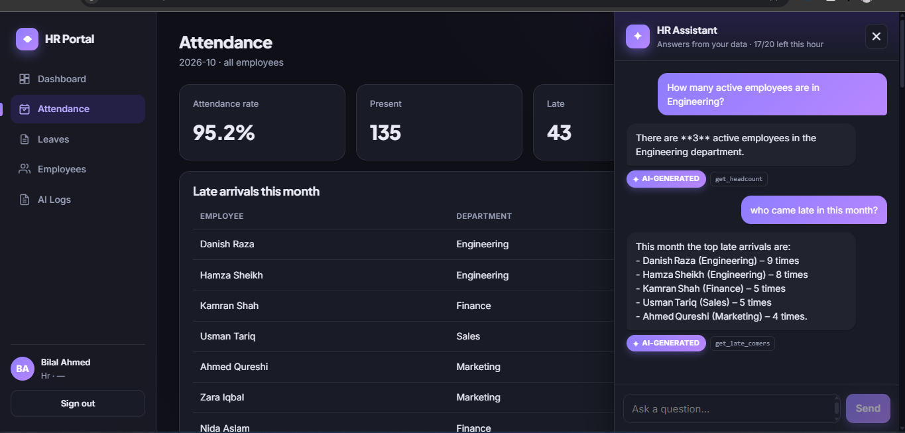
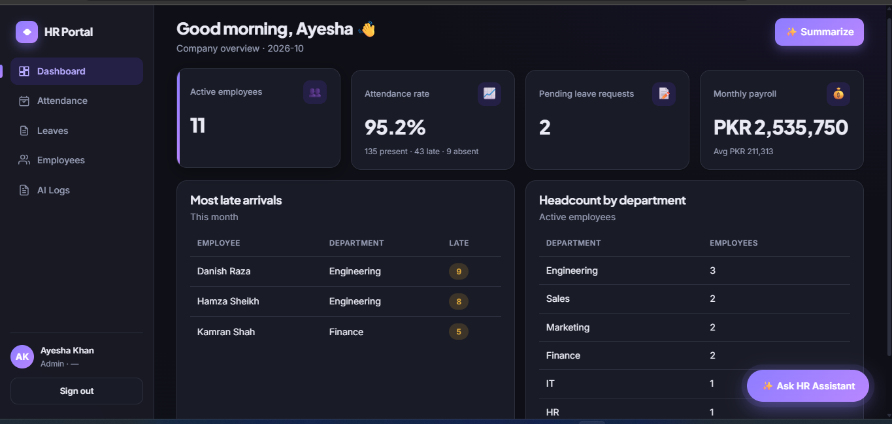
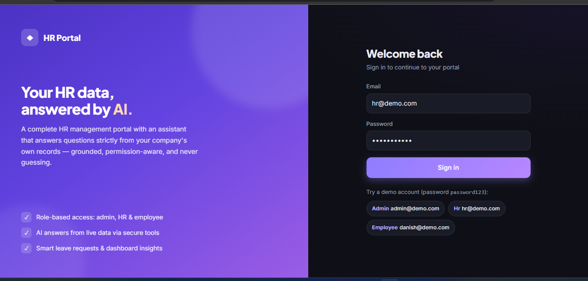
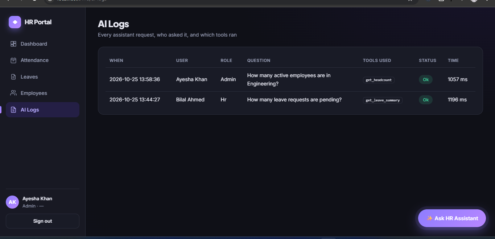
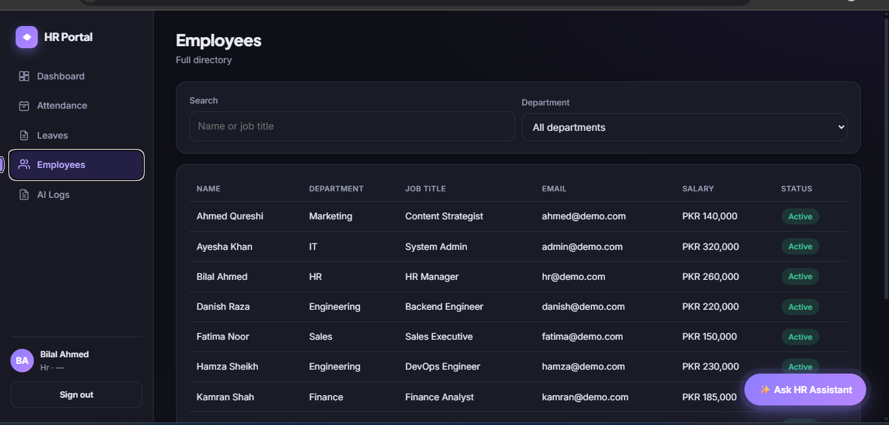
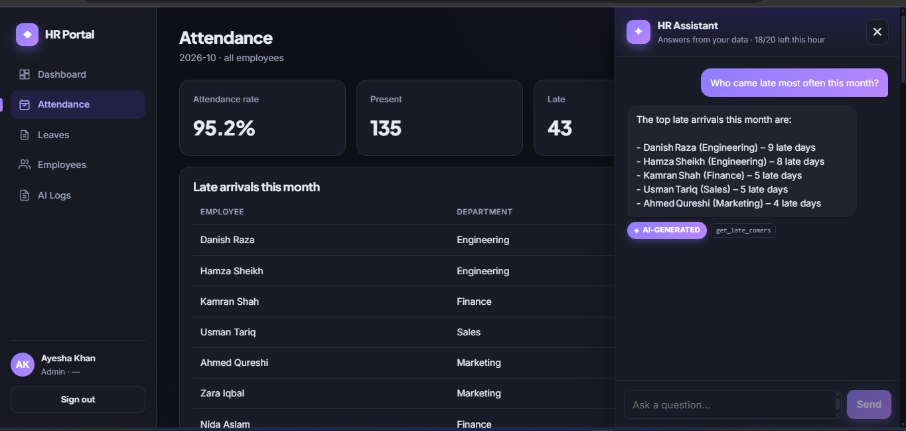

# HR Workflow AI Assistant

A small but complete HR management web app with a built-in **AI Assistant** that
answers questions strictly from the company's own data. React frontend, Node /
Express backend, SQLite database, and Groq (via the OpenAI-compatible SDK)
powering the assistant.

The AI only ever sees what the logged-in user is allowed to see — every answer
is grounded in a real database lookup, and the API key never leaves the backend.

---

## Screenshots

### AI Assistant — answers grounded in live HR data
Every answer carries an **AI-generated** badge and shows the exact secure tool it
called (`get_headcount`, `get_late_comers`, …). No tool, no number.



### Dashboard
Role-aware KPIs, most late arrivals and headcount by department — with a one-click
AI summary written only from the figures on screen.



| Login | AI Logs (audit trail) |
|-------|-----------------------|
|  |  |

| Employees directory | Assistant in context |
|---------------------|----------------------|
|  |  |

---

## Features

**HR portal**
- JWT login with three roles: **admin**, **hr**, **employee**
- Dashboard KPIs (headcount, attendance rate, pending leaves, payroll)
- Attendance, leaves, employees and payroll screens
- Role-based scope: employees only ever see their own records

**AI Assistant (ask-your-data)**
- 💬 **Chat** — natural-language questions answered from live HR data via tools
  (`get_headcount`, `get_attendance_summary`, `get_late_comers`,
  `get_leave_summary`, `get_my_leave_balance`, `get_payroll_summary`,
  `search_employees`)
- 📊 **Dashboard summary** — bullet insights computed only from the KPI JSON
  the screen is showing (no invented numbers)
- 📝 **Smart leave** — turns "I need Mon & Tue off for a wedding" into a
  pre-filled, validated leave form the employee still confirms themselves
- 🛡️ **Guardrails** — per-user hourly rate limit, 15s timeout with a friendly
  fallback, and a full audit log of every AI call (visible to admin/hr under
  **AI Logs**)

### How grounding works
The model has **no direct database access**. It can only call tools, and each
tool runs the *same* service function the REST API uses, with the *same* actor.
Permission checks live inside the services, so the model cannot widen its own
scope — an employee asking for a colleague's salary gets a polite refusal, not a
guess. Policy questions are answered only from the handbook text in
`backend/src/ai/prompt.js`.

---

## Project layout

```
AI Agent/
├── backend/            # Express API + AI orchestration
│   ├── src/
│   │   ├── ai/         # chat loop, tools, prompts, guardrails, routes
│   │   ├── services/   # business logic + permission checks (single source of truth)
│   │   ├── rest/       # REST routes
│   │   ├── db/         # schema.sql, seed.js, SQLite file
│   │   ├── middleware/ # auth (JWT) + error handler
│   │   ├── config.js   # env config; AI key read here, never sent to the client
│   │   └── server.js
│   └── .env.example
└── frontend/           # React + Vite SPA
    └── src/
        ├── pages/      # Dashboard, Attendance, Leaves, Employees, AiLogs, Login
        ├── components/ # ChatPanel, LeaveFormModal
        └── api.js      # fetch wrapper; JWT on every request
```

---

## Prerequisites
- **Node.js 18+** (tested on Node 24)
- A **Groq API key** — get a free one at https://console.groq.com/keys
  (the portal runs fine without it; only the AI features are disabled)

---

## Setup & run

### 1. Backend

```bash
cd backend
npm install
cp .env.example .env      # then edit .env (see below)
npm run seed              # create & seed the SQLite database
npm run dev               # start on http://localhost:4000  (npm start for prod)
```

Edit `backend/.env`:

```ini
PORT=4000
JWT_SECRET=change-this-to-a-long-random-string

# Groq — AI Assistant. Key lives ONLY here, never in the frontend.
AI_API_KEY=gsk_...                              # <-- paste your real Groq key here to turn AI on
AI_BASE_URL=https://api.groq.com/openai/v1
AI_MODEL=openai/gpt-oss-120b
AI_TIMEOUT_MS=15000
AI_RATE_LIMIT_PER_HOUR=20
```

> Leave `AI_API_KEY` blank and the app still runs — the assistant simply shows
> "Not configured on the server" and every AI endpoint returns `503`.

### 2. Frontend

```bash
cd frontend
npm install
npm run dev               # Vite dev server, proxies /api to the backend
```

Open the URL Vite prints (typically http://localhost:5173).

---

## Demo accounts

Every account uses the password **`password123`**.

| Role     | Email            | Can see                                   |
|----------|------------------|-------------------------------------------|
| Admin    | `admin@demo.com` | Everything, company-wide + AI Logs        |
| HR       | `hr@demo.com`    | Everything, company-wide + AI Logs        |
| Employee | `danish@demo.com`| Only their own attendance, leave, payslip |

Other employees: `sana@demo.com`, `hamza@demo.com`, `fatima@demo.com`,
`usman@demo.com`, `zara@demo.com`, `ahmed@demo.com`, `nida@demo.com`,
`kamran@demo.com` (same password).

---

## Try the assistant

Click **✨ Ask HR Assistant** (bottom-right). Example questions:

- *Admin/HR:* "How many active employees are in Engineering?" · "Who came late
  most often this month?" · "What is the total payroll this month?"
- *Employee:* "How many sick leaves do I have left this year?" · "What is my
  attendance rate this month?" · "What is the leave policy for sick leave?"

Ask an employee account for someone else's salary and watch it refuse — the
guardrail is in the service layer, not the prompt.

---

## Security notes
- The Groq API key is read only in `backend/src/config.js` and never sent
  to the browser; all AI calls go through the backend.
- Every request carries a JWT; the AI acts as the authenticated user and inherits
  their permissions through the shared service layer.
- `backend/.env` and the SQLite DB files are git-ignored. Change `JWT_SECRET`
  before any real deployment.

---

## npm scripts (backend)
| Command         | Does                                  |
|-----------------|---------------------------------------|
| `npm run dev`   | Start with `--watch` (auto-reload)    |
| `npm start`     | Start for production                  |
| `npm run seed`  | Drop, recreate and seed the database  |
